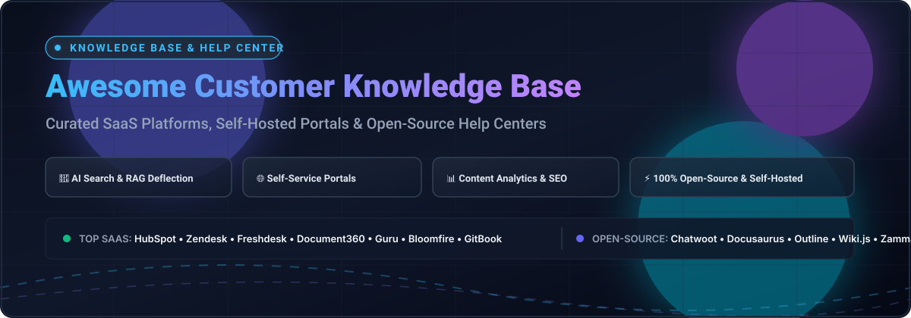

  

# 📚 Awesome Customer Knowledge Base & Help Center 🌟

  
  
  
  
  

---

## 🔍 Overview & Description

Welcome to the definitive, SEO-optimized curated directory of **Customer Knowledge Base**, **Help Center**, **Self-Service Support Portal**, and **Technical Documentation** platforms. 

Whether you are evaluating enterprise customer support SaaS suites with built-in ticketing deflection or deploying privacy-preserving, self-hosted open-source wikis with AI Retrieval-Augmented Generation (RAG), this guide indexes the modern ecosystem with verified pricing tiers, free tier constraints, company size/valuation benchmarks, and GitHub popularity metrics.

> **Key Capabilities Covered:**
> - 🤖 **AI-Powered Customer Search & Semantic Retrieval (RAG)**
> - 💬 **Self-Service Support Deflection & Automated FAQs**
> - 📈 **Article Performance Analytics & Search Intent Reporting**
> - 🏢 **Multi-Brand & Multilingual Knowledge Management**
> - 🛡️ **Role-Based Access Control (RBAC) & Enterprise SSO**
> - 💻 **Developer-First Git Sync & Markdown/MDX Workflows**

---

## 📑 Table of Contents

- [📊 Sector Overview & Market Dynamics](#-sector-overview--market-dynamics)
- [🏢 SaaS / Hosted Help Center Platforms](#-saas--hosted-help-center-platforms)
- [💻 Open-Source & Self-Hosted Solutions](#-open-source--self-hosted-solutions)
  - [Open-Source Architectural Distinctions](#-architectural-distinctions-in-open-source)
- [🤝 How to Contribute](#-how-to-contribute)
- [💖 Support](#-support)
- [📈 Star History](#-star-history)
- [⚖️ Disclaimer](#️-disclaimer)

---

## 📊 Sector Overview & Market Dynamics

The global **Knowledge Management and Customer Help Center Software** sector is estimated at **$16.2 billion to $23.2 billion in 2025–2026**, projected to exceed **$43 billion by 2030** at a Compound Annual Growth Rate (CAGR) of roughly 14%–18%, propelled by generative AI search, automated taxonomy, and Agentic RAG deflection.

The market structure is **moderately fragmented**: platform titans (HubSpot, Salesforce, Zendesk, Microsoft) command roughly 30%–35% of the aggregate market via consolidated CRM/helpdesk suites, while a dynamic and fragmented tier of specialized SaaS vendors (e.g., Document360, Helpjuice, Guru, GitBook) and self-hosted open-source platforms compete aggressively on specialized developer experience, AI authoring workflows, and data-sovereign self-hosting.

---

## 🏢 SaaS / Hosted Help Center Platforms

The table below tracks commercial SaaS platforms for customer knowledge bases and help centers, sorted descending by company size (market valuation / revenue).

| 🏷️ Product | 💼 Company Size (Valuation / Revenue) | 💵 Pricing Starting Tier | 🎁 Free Tier / Free Trial Limits | 🎯 Target Use & Trade-offs |
| :--- | :--- | :--- | :--- | :--- |
| **[HubSpot Knowledge Base](https://www.hubspot.com/)** | ~$12B Market Cap (NYSE: HUBS) / ~$3.13B+ ARR | Starts at **$90/seat/month** (billed annually) or **$100/seat/month** (monthly) under Service Hub Professional (requires paid seat + one-time onboarding) | **Free-forever CRM plan** (max 2 users, 1,000 contacts, basic ticketing & chat, no KB); **14-day free trial** of Service Hub Professional (full features including KB up to 2,000 articles, no credit card required) | **Best for**: Teams seeking a customer portal deeply tied into CRM and marketing pipelines.  **Trade-off**: High entry price; requires Service Hub Professional. |
| **[Zendesk Guide](https://www.zendesk.com/)** | $10.2B Acquisition Valuation / ~$1.5B+ ARR | Starts at **$55/agent/month** (billed annually) under Suite Team; Suite Professional is $115/agent/month | **No permanent free tier**; **14-day free trial** of Zendesk Suite Team/Professional (full feature access, capped at trial duration, no credit card required) | **Best for**: High-volume customer service desks needing ticketing + KB integration.  **Trade-off**: Suite Team tier minimum ($55/agent/mo); article limit 40,000. |
| **[Freshdesk Knowledge Base](https://www.freshworks.com/freshdesk/)** | ~$3.9B Market Cap (NASDAQ: FRSH) / ~$838M+ ARR | Starts at **$19/agent/month** (billed annually) or **$29/agent/month** (monthly) on Growth Plan; Pro is $55/agent/mo | **Free Program for up to 2 agents for 6 months** (ticketing + basic knowledge base portal, then converts to paid); **14-day free trial** of paid plans | **Best for**: Small to mid-size customer support teams needing an affordable help center.  **Trade-off**: Free program capped at 2 seats and expires after 6 months. |
| **[Guru](https://www.getguru.com/)** | $71M Raised (Series C) / Est. $20M+ ARR | Starts at **$5/user/month** (Starter, 5 users minimum billed annually) or **$10/user/month** (Builder); Free plan for small teams | **Free-forever tier for up to 3 core users** (unlimited light/read-only users, basic verification and Slack/Teams integrations, capped at 3 author seats) | **Best for**: Internal knowledge and contextual support delivery in Slack/Teams.  **Trade-off**: Per-seat cost scales with team size; primarily employee/agent-facing. |
| **[Document360](https://document360.com/)** | Bootstrapped (~$20M+ Kovai.co ARR; $10M+ Document360 ARR) | Starts at **$149/month** (historical baseline Standard plan; current model uses custom quote-based pricing starting from ~$149–$199/project/month) | **No permanent free tier**; **14-day free trial** (access to full workspace configuration, Eddy AI tools, and authoring features, no credit card required) | **Best for**: Dedicated customer help centers, documentation versioning, and AI search.  **Trade-off**: Quote-based pricing opacity; add-on costs for advanced AI credits. |
| **[Bloomfire](https://bloomfire.com/)** | $32.8M Raised / Est. $7M–$12M ARR | Starts at **$25/user/month** (typically requires 50-user minimum, creating an entry spend floor of ~$1,250/month billed annually) | **No permanent free tier**; **30-day free trial** for Starter tiers + self-guided interactive Test Drive demo | **Best for**: Mid-market and enterprise knowledge management with AI search.  **Trade-off**: High contract floor ($1,250/mo minimum commitment); no self-serve low tier. |
| **[GitBook](https://www.gitbook.com/)** | Lean VC / Est. $4M–$8M ARR | Starts at **$65/site/month** + **$12/user/month** (billed annually) or $79/site + $15/user/mo under Essential Plan | **Free-forever tier limited to 1 user** (public documentation, Git Sync with GitHub/GitLab, standard `*.gitbook.io` domain, basic GitBook agent queries) | **Best for**: Product and developer documentation with Git branch workflows.  **Trade-off**: Free plan limited to 1 editor; custom domains require paid tier. |
| **[Helpjuice](https://www.helpjuice.com/)** | Bootstrapped / Est. $2.5M–$4.5M ARR | Starts at **$249/month** (Customized KB, up to 30 users, 12GB storage, no AI); AI plan starts at $449/month (100 users) | **No permanent free tier**; **14-day free trial** (unrestricted access to all features, no credit card required) | **Best for**: Teams wanting standalone, customizable customer help centers.  **Trade-off**: High starting cost ($249/mo minimum); read-only users consume paid seats. |
| **[Archbee](https://www.archbee.com/)** | $4M Raised (YC S21) / Est. $2M ARR | Starts at **$80/month** (Growing plan, billed annually: 10GB storage + 2GB per user, unlimited readers); Scaling is $350/month | **No permanent free tier**; **14-day free trial** (full access to API docs and knowledge portals, no credit card required) | **Best for**: Developer docs, API references, and client-facing knowledge portals.  **Trade-off**: No permanent free tier; premium jump to scaling plan ($350/mo). |
| **[Slab](https://slab.com/)** | $2.2M Raised (Series A) / Est. $1.5M ARR | Free tier available; paid plans start at **$6.67/user/month** (billed annually) or $8/user/month under Startup tier | **Free-forever plan with unlimited users**, capped at **1 workspace, 2,000 monthly AI credits, 1 GB file storage, and 100,000 API requests/month** | **Best for**: Modern internal wikis with unified search across Drive, Slack, and GitHub.  **Trade-off**: Credit-based AI limits across all tiers; focused on internal teams. |

---

## 💻 Open-Source & Self-Hosted Solutions

The table below tracks open-source and self-hosted solutions for customer help centers, self-service portals, documentation hubs, and knowledge bases, sorted descending by GitHub Stars_Count.

| 📦 Project | ⭐ GitHub_Stars | 📜 License | 🛠️ Tech Stack | 📝 Description & Help Center Capabilities |
| :--- | :--- | :--- | :--- | :--- |
| **[Docusaurus](https://github.com/facebook/docusaurus)** |  | MIT | React, Node.js | Static-site documentation platform with built-in search, localization, versioning, and Markdown/MDX support. Ideal for self-hosted customer documentation portals. |
| **[Chatwoot](https://github.com/chatwoot/chatwoot)** |  | AGPL-3.0 | Ruby on Rails, Vue | Omnichannel customer communication platform featuring a native, public-facing **Help Center & Knowledge Base** portal with multi-brand and multilingual support integrated directly into live ticketing. |
| **[Outline](https://github.com/outline/outline)** |  | BSL 1.1 | Node.js, React | Fast, collaborative team knowledge base and wiki with a Notion-like markdown editor, real-time collaboration, and access controls (requires external OIDC/SSO). |
| **[Slate](https://github.com/slatedocs/slate)** |  | Apache-2.0 | Ruby, Middleman | Clean, responsive three-column documentation tool inspired by Stripe's API docs. Generates static, searchable single-page customer and API reference hubs. |
| **[Wiki.js](https://github.com/Requarks/wiki)** |  | AGPL-3.0 | Node.js, Vue, PostgreSQL | Modern and extensible wiki software supporting Markdown/WYSIWYG/HTML editors, multi-lingual portals, Git storage synchronization, and granular RBAC. |
| **[MkDocs Material](https://github.com/squidfunk/mkdocs-material)** |  | MIT | Python, Markdown | Highly configurable documentation framework on top of MkDocs with instant client-side offline search, dark mode, feedback widgets, and enterprise documentation layouts. |
| **[Docmost](https://github.com/docmost/docmost)** |  | AGPL-3.0 | NestJS, React, PostgreSQL | Open-source collaborative wiki and knowledge management software. Features spaces, real-time page collaboration, native diagram drawing, and built-in user management. |
| **[BookStack](https://github.com/BookStackApp/BookStack)** |  | MIT | PHP, Laravel, MySQL | Opinionated, structured self-hosted wiki platform organized into Shelves, Books, Chapters, and Pages. Features simple WYSIWYG/Markdown editing and public/private access rules. |
| **[Zammad](https://github.com/zammad/zammad)** |  | AGPL-3.0 | Ruby on Rails, PostgreSQL | Open-source web-based ticketing and customer support system with a native **Knowledge Base** module allowing public self-service portals and internal agent answer deflection. |
| **[FreeScout](https://github.com/freescout-helpdesk/freescout)** |  | AGPL-3.0 | PHP, Laravel, MySQL | Lightweight open-source help desk and shared inbox (Zendesk/Help Scout alternative) offering a dedicated Knowledge Base module for public customer self-service articles. |
| **[Synthadoc](https://github.com/axoviq-ai/synthadoc)** |  | Apache-2.0 | Python | Local-first LLM knowledge compilation engine that processes raw documents into interconnected Markdown wikis with Obsidian integration and local API endpoints. |
| **[Red Arch Knowledge Manager (KM2)](https://github.com/redarchlabs/red-arch-km)** |  | Apache-2.0 | FastAPI, Next.js, PostgreSQL | Governed AI knowledge management platform combining vector search (Qdrant), knowledge graphs (Neo4j), passage-level citation RAG, and field-level Row-Level Security (RLS). |

---

### 🧩 Architectural Distinctions in Open-Source

- 🎯 **Customer-Facing Portals with Integrated Support:** Tools like **[Chatwoot](https://github.com/chatwoot/chatwoot)**, **[Zammad](https://github.com/zammad/zammad)**, and **[FreeScout](https://github.com/freescout-helpdesk/freescout)** provide both a customer ticketing system and a public-facing help center / knowledge base out-of-the-box.
- ⚡ **Static Documentation Generators:** Platforms like **[Docusaurus](https://github.com/facebook/docusaurus)**, **[Slate](https://github.com/slatedocs/slate)**, and **[MkDocs Material](https://github.com/squidfunk/mkdocs-material)** allow support and engineering teams to deploy blazing-fast, static, searchable help centers hosted on GitHub Pages, Cloudflare Pages, or AWS S3 with zero hosting cost.
- 📖 **Collaborative Team Wikis:** Platforms like **[Outline](https://github.com/outline/outline)**, **[Docmost](https://github.com/docmost/docmost)**, **[Wiki.js](https://github.com/Requarks/wiki)**, and **[BookStack](https://github.com/BookStackApp/BookStack)** excel at hierarchical, structured document organization and internal SOP management.
- 🧠 **Next-Gen AI & Local Engines:** Frameworks like **[Red Arch KM2](https://github.com/redarchlabs/red-arch-km)** and **[Synthadoc](https://github.com/axoviq-ai/synthadoc)** focus on governed RAG, semantic graph retrieval, and compiling unorganized files into structured knowledge.

---

## 🤝 How to Contribute

Contributions are warmly welcomed! Help keep this knowledge base index accurate and comprehensive:

1. 🍴 Fork the repository.
2. 📝 Add or edit entries in [`README.md`](file:///C:/Users/ishan/Documents/Projects/Awesome-Customer-Knowledge-Base-Help-Center/README.md) following the established table structure.
3. 🔍 Ensure verified pricing, free tier limits, and accurate technology badges.
4. 🚀 Submit a Pull Request with a brief explanation of your additions.

🌟 Star the repository if you find it valuable!

---

## 💖 Support

Thank you for exploring and utilizing **Awesome-Customer-Knowledge-Base-Help-Center**! If you find this curated collection helpful for your team, company, or open-source infrastructure, please consider supporting the project:

- ⭐ **Star this repository** on GitHub to show your appreciation and boost discoverability.
- 🍴 **Fork and share** it with your support engineering, developer relations, and product communities.
- ☕ **Buy me a coffee & support ongoing maintenance:** Visit the [GitHub Sponsors Dashboard](https://github.com/sponsors/ishandutta2007) to sponsor!

Your backing helps keep these pricing benchmarks, project analyses, and market dynamics up to date.

---

## 📈 Star History

---

## ⚖️ Disclaimer

- 📌 This is a **community-curated** list — not exhaustive and not an endorsement.
- 🔒 Knowledge base platforms handling customer data must comply with data protection regulations (GDPR, CCPA, etc.) and implement appropriate access controls for internal and external documentation.
- 💡 **The "customer-facing help center" vs. "internal wiki" vs. "knowledge platform" distinction is critical.** Zendesk Guide, Document360, Helpjuice, Freshdesk KB, and HubSpot KB are customer-facing help centers. Guru and Slab focus primarily on internal employee knowledge.
- 💲 Pricing details, trial duration, and seat minimums are subject to change by vendors; always check official vendor pricing pages before purchasing.
- 🛡️ Self-hosted open-source solutions require proper infrastructure, security hardening, and ongoing maintenance. Ensure your deployment meets your organization's security and privacy compliance standards before publishing customer-facing documentation.

---

  <b>Built for support teams, documentation leads, and organizations crafting modern self-service knowledge portals.</b>

